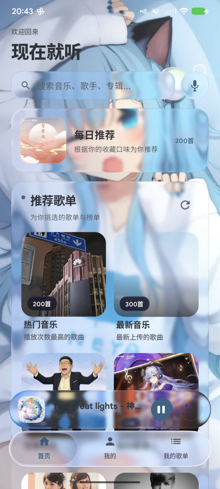
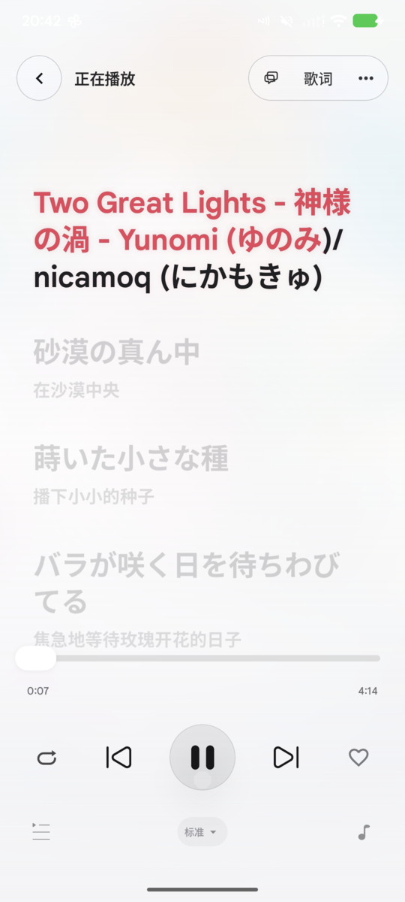
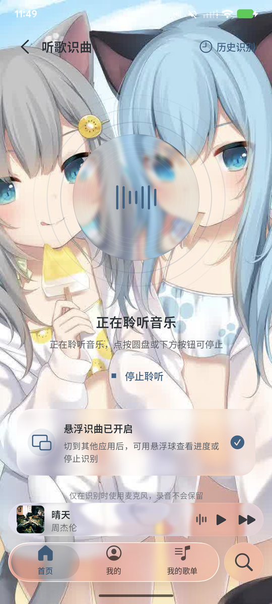

# Neko歌姬计划安卓版


> [!TIP]
> 🐾 **pc端入口**：[点击这里查看 Neko歌姬计划 pc版仓库](https://github.com/MinecraftNekoServer/NekoMusicForPc)
> 🐾 **后端**：[点击这里查看 Neko歌姬计划 后端仓库](https://github.com/FantasyNetworkCN/NekoMusic)

# 本平台唯一官网 https://music.nekocore.cn
- ## 请勿通过非官方渠道获取安装包。本站被大量非法黑产生成盗版客户端诈骗，如你通过第三方平台获取安装包导致被骗本站拒绝一切赔偿

<p align="center">
  
</p>

## 项目介绍

Neko 歌姬计划 Android 客户端基于 Kotlin 与 Jetpack Compose 构建，接入 Neko 自托管曲库与
统一账号体系。应用支持在线播放、每日推荐、收藏与歌单、逐字歌词、一起听、后台听歌识曲，
并可从网易云音乐、QQ 音乐、酷狗音乐导入外部歌单。

- **同一账号与曲库**：通过系统浏览器完成 NekoAuth 登录，播放、收藏和歌单与 Web / PC 同步。
- **后台实时识曲**：通过 WebSocket 持续发送 16 kHz PCM，在自有曲库中实时匹配。
- **完整播放体验**：逐字歌词、播放模式、倍速、定时关闭、桌面歌词与通知控制。
- **多人一起听**：创建或加入房间，由服务端统一同步播放状态。
- **歌单迁移**：支持外部平台歌单链接 / ID 导入并匹配站内曲库。
- **安装包安全**：只从官方站点或本仓库发布页获取 APK。

### NekoAuth 登录

Android 使用系统浏览器完成 NekoAuth 授权，注册、账号中心与找回密码入口也直接打开系统浏览器。
登录完成后，`https://music.nekocore.cn/sso/native-complete` 或 `nekomusic://sso/complete` 拉起应用，
客户端接收一次性 handoff 并建立登录态。
登录回跳只携带一次性 handoff，不会把账号访问令牌放进链接。

### 播放音量与音源分离

播放页底部左侧显示音量图标，点击后打开音频模态框，可在“音量”和“EQ”之间切换。
普通音量与手机音量键和系统音量面板同步；EQ 提供 31 Hz–16 kHz 十段增益、
±12 dB 预增益、平坦/流行/摇滚/爵士/古典/人声/重低音/高音预设和重置，设置会持久化。
EQ 位于 AI 人声/伴奏混音之后，只处理最终音频；调节 EQ 或切换 EQ 开关不会重新运行 AI 推理。
设置页「播放与存储」中的「人声与伴奏调节」开启后，底部只显示人声、伴奏两路滑条。
开关、分离方式和两路音量保存在本地，进程重启后恢复；一起听期间也可使用，仅影响本机声音。
分离设置和两路音量仅在本机使用，房间仍负责同步播放进度。

- **无 AI 计算分离（默认）**：在解码音频上使用 1024 采样点频谱窗口，边播放边处理，无需模型或额外下载歌曲。
  按声道相干性与频段估计居中的人声，可能混入乐器，单声道效果有限，不等同于神经网络音源分离。
- **AI 分离**：选择后独立检查并下载约 28 MB 模型，无需正在播放歌曲。选项下直接显示模型下载百分比、已下载量及完成状态；失败可重试，已有完整模型会复用。歌曲只在本机处理。
  直接使用播放器解码得到的音频，分块处理并在内存中保留当前待播片段的分离结果。两路滑条即时修改混音比例。
  推理赶不上时，当前片段会播放原曲。切歌、跳转进度时清除旧片段，从新位置开始处理。
  默认使用 XNNPACK，并增加 6 秒 AudioTrack 预缓冲与最多 3 秒的分片等待，避免后台播放时因推理稍慢立即回退原曲。
  WebGPU、NNAPI 和纯 CPU 作为后端回退。WebGPU 虽然单次推理更快，但在部分 Android 设备后台运行时可能挂起，因此不作为默认后端。

模型为 [UVR_MDXNET_1_9703](https://github.com/TRvlvr/model_repo/releases/tag/all_public_uvr_models)，
客户端通过国内代理下载，不直连 GitHub；主代理失败时自动尝试备用代理，下载后仍校验固定 SHA-256。
输入规格与推理参数参考 [Ultimate Vocal Remover](https://github.com/Anjok07/ultimatevocalremovergui)。
推理使用 [ONNX Runtime](https://github.com/microsoft/onnxruntime)，频谱变换使用
[JTransforms](https://github.com/wendykierp/JTransforms)。模型下载后验证固定的 SHA-256，再加载到内存。

### 空间管理

设置页「播放与存储」中的「空间管理」统计本软件的安装包、音乐缓存、封面与歌词缓存、AI 模型、
数据库、应用设置、本地文件、其他缓存、其他应用数据及外部缓存，并按本软件总占用展示每一项比例。
页面同时显示设备总容量、已用空间和可用空间；音乐缓存列表仍可在同一页面查看和清理。

### 界面预览

| 首页与每日推荐 | 播放页与逐字歌词 |
| --- | --- |
|  |  |

| 播放菜单与定时关闭 | 后台听歌识曲 |
| --- | --- |
|  |  |

### 获取外部歌单api
获取qq歌单列表`https://music.nekocore.cn/loser1/getSongListDetail?disstid=歌单id`
获取网易云歌单列表`https://music.nekocore.cn/loser/playlist/track/all?id=歌单id`

## Deep Link 外部唤醒

支持通过浏览器或其他 App 唤醒 Neko歌姬计划，并直接跳转到指定页面。

### 支持的 Scheme

| Scheme | 说明 |
|--------|------|
| `nekomusic://` | 自定义协议，适合 App 间调用 |

### 音乐播放页

仅需要音乐 ID，应用会自动通过 API 获取歌曲信息并打开播放页。

```
nekomusic://player/{musicId}
```

**示例：**
```bash
adb shell am start -a android.intent.action.VIEW -d "nekomusic://player/48" com.neko.music
```

### 歌单详情页

仅需要歌单 ID，应用会自动通过 API 获取歌单名称并打开歌单详情页。

```
nekomusic://playlist/{playlistId}
```

### 一起听房间

分享网页 `/together/{token}` 只负责拉起客户端。Android 处理以下深链后会加入对应房间：

```
nekomusic://together/{token}
```

客户端内在播放页右上角分享菜单选择「一起听」即可创建或添加到房间；创建后会自动复制随机房间 URL。

### 网页调用示例

在 HTML 中放置以下链接，用户点击即可唤醒应用：

```html
<a href="nekomusic://player/48">播放歌曲</a>
<a href="nekomusic://playlist/1">打开歌单</a>
```
