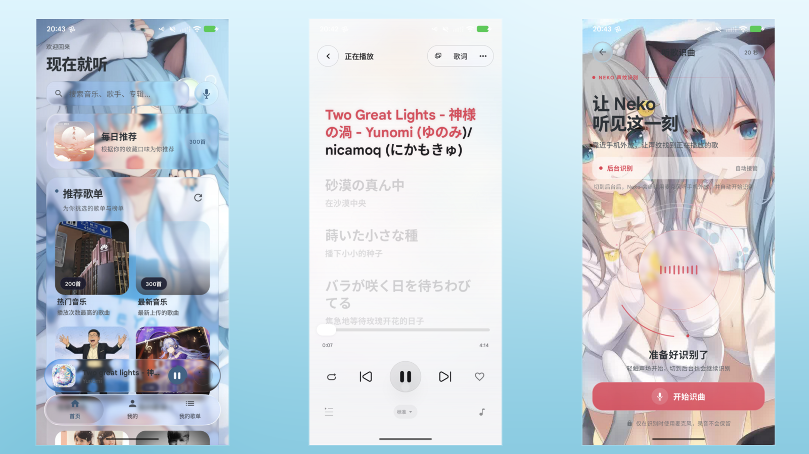
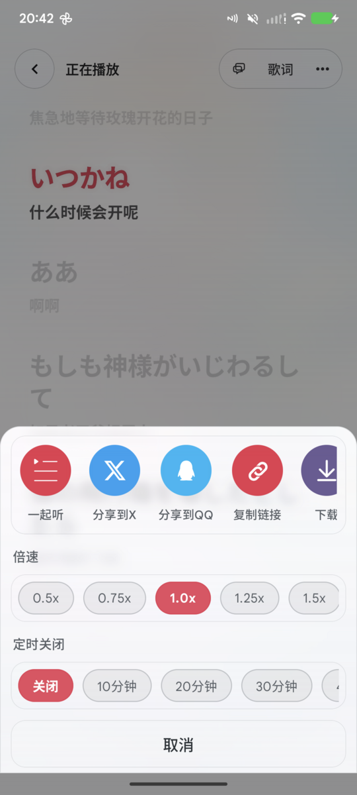

# Neko歌姬计划安卓版


> [!TIP]
> 🐾 **pc端入口**：[点击这里查看 Neko歌姬计划 pc版仓库](https://github.com/MinecraftNekoServer/NekoMusicForPc)
> 🐾 **后端**：[点击这里查看 Neko歌姬计划 后端仓库](https://github.com/FantasyNetworkCN/NekoMusic)

# 本平台唯一官网 https://music.nekocore.cn
- ## 请勿通过非官方渠道获取安装包。本站被大量非法黑产生成盗版客户端诈骗，如你通过第三方平台获取安装包导致被骗本站拒绝一切赔偿

<p align="center">
  
</p>

## 项目介绍

Neko 歌姬计划 Android 客户端基于 Kotlin 与 Jetpack Compose 构建，接入 Neko 自托管曲库与
统一账号体系。应用支持在线播放、每日推荐、收藏与歌单、逐字歌词、一起听、后台听歌识曲，
并可从网易云音乐、QQ 音乐、酷狗音乐导入外部歌单。

- **同一账号与曲库**：通过 NekoAuth 在应用内登录，播放、收藏和歌单与 Web / PC 同步。
- **后台实时识曲**：通过 WebSocket 持续发送 16 kHz PCM，在自有曲库中实时匹配。
- **完整播放体验**：逐字歌词、播放模式、倍速、定时关闭、桌面歌词与通知控制。
- **多人一起听**：创建或加入房间，由服务端统一同步播放状态。
- **歌单迁移**：支持外部平台歌单链接 / ID 导入并匹配站内曲库。
- **安装包安全**：只从官方站点或本仓库发布页获取 APK。

### 界面预览

| 首页与每日推荐 | 播放页与逐字歌词 |
| --- | --- |
|  |  |

| 播放菜单与定时关闭 | 后台听歌识曲 |
| --- | --- |
|  |  |

### 获取外部歌单api
获取qq歌单列表`https://music.nekocore.cn/loser1/getSongListDetail?disstid=歌单id`
获取网易云歌单列表`https://music.nekocore.cn/loser/playlist/track/all?id=歌单id`

## Deep Link 外部唤醒

支持通过浏览器或其他 App 唤醒 Neko歌姬计划，并直接跳转到指定页面。

### 支持的 Scheme

| Scheme | 说明 |
|--------|------|
| `nekomusic://` | 自定义协议，适合 App 间调用 |

### 音乐播放页

仅需要音乐 ID，应用会自动通过 API 获取歌曲信息并打开播放页。

```
nekomusic://player/{musicId}
```

**示例：**
```bash
adb shell am start -a android.intent.action.VIEW -d "nekomusic://player/48" com.neko.music
```

### 歌单详情页

仅需要歌单 ID，应用会自动通过 API 获取歌单名称并打开歌单详情页。

```
nekomusic://playlist/{playlistId}
```

### 一起听房间

分享网页 `/together/{token}` 只负责拉起客户端。Android 处理以下深链后会加入对应房间：

```
nekomusic://together/{token}
```

客户端内在播放页右上角分享菜单选择「一起听」即可创建或添加到房间；创建后会自动复制随机房间 URL。

### 网页调用示例

在 HTML 中放置以下链接，用户点击即可唤醒应用：

```html
<a href="nekomusic://player/48">播放歌曲</a>
<a href="nekomusic://playlist/1">打开歌单</a>
```
